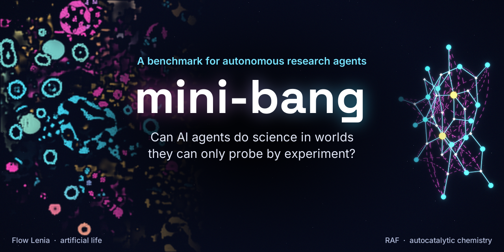
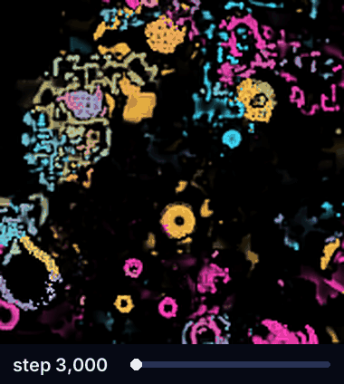
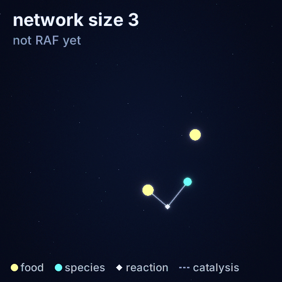
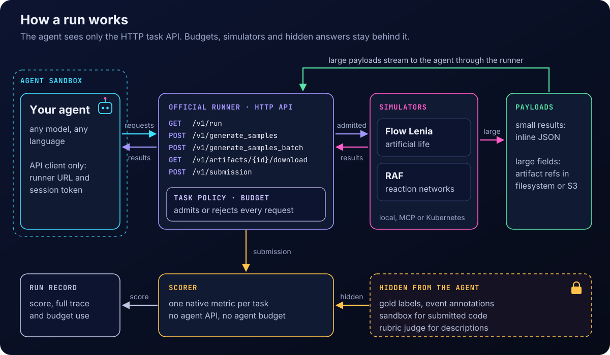

<p align="center">
  
</p>

<p align="center"><b>Can an AI agent detect, describe and predict <i>minibangs</i>, sudden transitions of a whole
system, in simulated worlds it can only probe through a budget of experiments?</b></p>

<p align="center">
  
  
  
  
</p>

<p align="center">
  <a href="#what-mini-bang-measures">What it measures</a> ·
  <a href="#tasks">Tasks</a> ·
  <a href="#how-it-works">How it works</a> ·
  <a href="#quickstart">Quickstart</a> ·
  <a href="#how-scoring-works">Scoring</a> ·
  <a href="#participation-rules">Rules</a> ·
  <a href="#adding-simulators-and-tasks">Extending</a> ·
  <a href="#citation">Citation</a>
</p>

---

**mini-bang** is a benchmark for autonomous research agents. An agent is dropped into a
simulated world, gets a question and a budget of experiments, and must come back with a
prediction, an interval, an explanation or a piece of executable analysis code. It never
sees the answers: every observation goes through a budgeted task API, and a separate scorer
that the agent cannot reach compares the submission with hidden ground truth (*gold*).

## What mini-bang measures

**Autonomous scientific discovery in complex simulated worlds.** The agent has to decide
which experiments to run, read noisy and high-dimensional results, form a hypothesis and
commit to an answer under a fixed budget. Answers cannot be looked up: the worlds come from
the benchmark's own simulators, and the labels exist only in hidden annotations.

**Minibangs.** A *minibang* is a short stretch of time in which the organization of a whole
system changes qualitatively: something new appears and persists. Each world has its own kind:

<table>
  <tr>
    <td width="50%" align="center">
      <br>
      <b>Flow Lenia</b>: a continuous artificial-life world. Populations of species-like
      creatures form, move, compete and reorganize. Its minibangs are rapid changes between
      established population regimes, marked by humans in long rollouts. No labels are shown
      here: finding them is the task.
    </td>
    <td width="50%" align="center">
      <br>
      <b>RAF chemistry</b>: a reaction network grows one molecule at a time. Its minibang
      is the growth step at which the network becomes a RAF set (reflexively autocatalytic
      and food-generated): every reactant can be built from the food set, and so can a
      catalyst of every reaction.
    </td>
  </tr>
</table>

<sub>Both animations are fresh runs of the benchmark simulators with seeds outside every
evaluation set.</sub>

**Levels of understanding.** One transition can be described in several languages, from
what was seen to what it makes possible. Each task is assigned to one level:

| Level | Language | Question about a transition |
| --- | --- | --- |
| 1 | Phenomenology | What changed, when, and at what scale? |
| 2 | Organization | What new structure formed, and what became self-sustaining in it? |
| 3 | Causality | Which mechanism produced the transition, and can it be undone? |
| 4 | Function | Which limit did the transition lift, and what does the new organization keep steady? |
| 5 | Generativity | 5a, openness: which new possibilities became reachable? 5b, generation: which further transitions does it trigger, and how fast? |

The current tasks score levels 1, 2, 3 and 5a; levels 4 and 5b have no tasks yet. Levels are
languages of description, not skills of the agent.

## Tasks

Eleven tasks, twelve variants (localization also has an inside-point variant). A full pass
is 33 agent attempts: one per variant, except the description task, which runs once for each
of its 22 annotated events. Scores run from 0 to 1, higher is better: 0 is a reference
answer without insight (the best constant, chance, or naive counting within the budget) and 1
is a perfect answer or the information limit. The description task is scored by rubric.

| Task | World | Level | What the agent must do | Score |
| --- | --- | :-: | --- | --- |
| `flow_lenia/presence` | Flow Lenia | 1 | Give the probability that each time window contains a minibang | Brier skill, class-balanced |
| `flow_lenia/localization` | Flow Lenia | 1 | Find the start and end of every minibang in each window; the inside-point variant starts from one moment inside the event | Interval soft F1 above chance |
| `flow_lenia/discriminate` | Flow Lenia | 1 | Decide whether a window holds a minibang and, if not, why the apparent transition is not one | Quadratic-score skill over minibang and rejection reasons |
| `flow_lenia/minibang-metric` | Flow Lenia | 1 | Submit code for one scalar that separates minibang windows from ordinary ones | AUROC skill on hidden windows |
| `flow_lenia/representation` | Flow Lenia | 2 | Submit code that compresses a window into at most 8 numbers; a fixed probe must detect minibangs from them | Leave-pair-out AUROC skill of a fixed probe |
| `flow_lenia/describe` | Flow Lenia | 2 | Describe how the population dynamics change before, during and after one annotated event | Rubric coverage and factual precision, with penalties for trap claims |
| `raf/timing` | RAF | 1 | Estimate when each target species first appears in the listed test networks | Log-likelihood skill |
| `raf/signature` | RAF | 2 | Label which test networks are RAF at each listed size | Soft F1 above chance |
| `raf/mechanism-prob` | RAF | 3 | Infer the RAF probability of network families with a hidden catalysis rate at sizes larger than any allowed experiment | Bernoulli KL skill |
| `raf/mechanism-seq` | RAF | 3 | Forecast molecule counts along growing networks from what is visible at their first size | Pinball-loss skill |
| `raf/predictive` | RAF | 5a | Forecast whether hidden growing networks become RAF at sizes larger than any allowed experiment | Bernoulli KL skill |

Every instance states its exact design, observation budget, answer format and score in its
instructions; `mini-bang task show <task>` prints them. The
[RAF task protocols](docs/raf_tasks.md) give the RAF rules in full.

## How it works

<p align="center">
  
</p>

- **One door.** Agents talk only to the official runner over HTTP with a per-session
  bearer token. The raw simulation backend is never exposed to them.
- **Policy and budget.** Each task's policy checks every request against the allowed shape
  and spends budget before anything runs; a batch is admitted atomically or not at all.
- **Simulators.** Flow Lenia observations come from an external annotated checkpoint pool
  or from JAX replay; RAF networks are grown and simulated on demand. Execution runs in a
  local process pool, through MCP or on fixed Kubernetes worker pools.
- **Payloads.** Small results come back as JSON; large fields become artifact refs that the
  agent streams from the runner.
- **Scoring.** A separate scorer, which the agent cannot reach, holds the hidden gold, a
  sandbox for submitted code and, for descriptions, an external rubric judge. It uses neither
  the agent API nor the agent budget.

The architecture map is in [`DOC.md`](DOC.md); external input data follows the
[artifact contract](docs/artifacts.md).

## Quickstart

### 1. Install

Use any conda environment with Python 3.11 or newer (create one only if you have none):

```bash
cd mini-bang                            # your clone of this repository
conda activate YOUR_ENVIRONMENT        # or: conda create -n mini-bang python=3.11 && conda activate mini-bang
python -m pip install -e '.[all,dev]'
mini-bang task list
mini-bang task show raf/mechanism-prob
```

For an uninstalled checkout, use `PYTHONPATH=src python -m mini_bang` in place of
`mini-bang`; `mini-bang doctor` checks the deployment described in `mini-bang.yaml`; the default file
describes a Kubernetes deployment, so kubectl and helm errors are expected on a machine
without a cluster.
Every task runs locally. Dev instances are scored locally with the gold shipped in the
package ([step 4](#4-read-the-result)); test instances are scored only by the scoring server
([step 5](#5-submit-to-the-scoring-server)). Flow Lenia tasks read an external annotated
checkpoint pool ([run guide](docs/current_benchmark_run.md)).

### 2. Start the official runner

Reported scores come from an isolated deployment: the Docker Compose stack or Kubernetes,
both described in the [CLI guide](docs/cli.md). For a first local try, start the same runner
process directly on your machine:

```bash
export MINI_BANG_RUNNER_ADMIN_TOKEN="$(python -c 'import secrets; print(secrets.token_urlsafe(32))')"
MINI_BANG_BACKEND=local MINI_BANG_PAYLOAD_MODE=auto MINI_BANG_PAYLOAD_STORE=filesystem \
MINI_BANG_PAYLOAD_DIR=workdir/runs/local-runner/payloads \
MINI_BANG_RESULT_DIR=workdir/runs/local-runner/results \
  python -m mini_bang.client.cli.official_runner --host 127.0.0.1 --port 8765
```

In a second shell, open a session for one task. The response holds the session id and its
bearer token:

```bash
curl -s -X POST http://127.0.0.1:8765/v1/runs \
  -H "Authorization: Bearer $MINI_BANG_RUNNER_ADMIN_TOKEN" \
  -H 'Content-Type: application/json' -d '{"task_id": "raf/mechanism-prob"}'
# -> {"session_id": "...", "session_token": "...", "instructions": "...", "protocol": "...", "capabilities": {...}}
```

### 3. Write a minimal agent

An agent is any program that speaks HTTP. This one uses only the Python standard library,
so it runs in an environment without the benchmark package (see the
[participation rules](#participation-rules)): it reads the task, runs ten experiments per network family and
submits a deliberately naive answer.

```python
import json, os, urllib.request

URL = os.environ["MINI_BANG_RUNNER_URL"]        # http://127.0.0.1:8765
TOKEN = os.environ["MINI_BANG_RUNNER_TOKEN"]    # session_token
SESSION = os.environ["MINI_BANG_RUN_ID"]        # the runner puts the session id here

def call(method, path, body=None):
    data = None if body is None else json.dumps({"session_id": SESSION, **body}).encode()
    request = urllib.request.Request(URL + path, data=data, method=method, headers={
        "Authorization": f"Bearer {TOKEN}", "Content-Type": "application/json"})
    with urllib.request.urlopen(request) as response:
        return json.load(response)

task = call("GET", f"/v1/run?session_id={SESSION}")
print(task["instructions"])                      # answer format and score
print(task["protocol"])                          # submission, budget and result rules
print(task["capabilities"])                      # budget and allowed requests

# Experiment: is a network grown to size 12 a RAF set? "saturation" is the network size,
# each macro seed grows a different network, and every request names a network family.
targets = task["metadata"]["saturations"]        # sizes no experiment can reach
answer = {}
for family in task["metadata"]["network_families"]:
    n, hits = 10, 0
    for seed in range(n):
        result = call("POST", "/v1/generate_samples", {
            "saturation": 12, "runs": 1, "extras": ["is_raf"],
            "macro_params": {"family": family, "seed": seed}})
        hits += result["payload"]["is_raf"]
    p = (hits + 1) / (n + 2)                     # smoothed RAF frequency at size 12
    answer[family] = {str(T): p for T in targets}
call("POST", "/v1/submission", {"answer": {"probabilities": answer}})
```

```bash
MINI_BANG_RUNNER_URL=http://127.0.0.1:8765 MINI_BANG_RUN_ID=<session_id> \
MINI_BANG_RUNNER_TOKEN=<session_token> python minimal_agent.py
```

Python agents can instead implement `solve(task)` and return a `TaskSubmission`
(`from mini_bang.framework import TaskSubmission`, shipped with the API client); `mini-bang-agent --agent
my_package.agents:MyAgent`, part of the API client, connects such an agent to the runner
with the same environment variables. Other endpoints: `POST /v1/generate_samples_batch` for atomic
batches and `GET /v1/artifacts/<id>/metadata|download` for large payloads. The `protocol` field
states the rules every task shares ([agent protocol](docs/cli.md#agent-protocol)): one final
submission per session, each request of a batch charged like a single call, `remaining_budget` in
every simulation response, and no score in the agent's `GET /v1/result`.

### 4. Read the result

```bash
curl -s "http://127.0.0.1:8765/v1/result?session_id=<session_id>" \
  -H "Authorization: Bearer $MINI_BANG_RUNNER_ADMIN_TOKEN"
```

The run record holds the submission and the full request trace. Runs and large observations
stay under the ignored `workdir/` directory. The runner checks the answer against the format
in the instructions and refuses a malformed one with HTTP 400, so the agent can correct it.
A dev instance is then scored with its gold from `src/mini_bang/tasks/*/gold/`; a test
instance keeps the answer with status `stored` until it is sent to the scoring server. The
agent's own `GET /v1/result` never shows a score.

### 5. Submit to the scoring server

The organizers give each participant a scoring server URL and a token. Save the admin
result of step 4 (or use a saved run directory) and send it with the agent's log:

```bash
export MINI_BANG_SERVER_URL=https://<scoring server> MINI_BANG_SERVER_TOKEN=<participant token>
curl -s "http://127.0.0.1:8765/v1/result?session_id=<session_id>" \
  -H "Authorization: Bearer $MINI_BANG_RUNNER_ADMIN_TOKEN" > run.json
mini-bang submit run.json --agent-log agent-transcript.jsonl
```

With both variables set when the runner starts, the runner forwards each test submission
itself. The server checks the format again (a malformed answer is refused and not counted),
scores the answer and returns the score. Each token gets one scored submission per test
instance.

## How scoring works

- **Open and private parts.** This repository holds the framework, simulators, CLI, local
  runner, task packages (instances, APIs, policies, scorers, answer formats), the gold of dev
  instances, the docs and the tests. The gold of test instances (labels, hidden seeds and
  family parameters, annotated event intervals), the reference descriptions of the rubric
  judge and the scoring service are private; the scoring server runs the scorers of this
  package on them.
- **Native metrics.** Each task reports its own score on the 0-to-1 scale described under
  [Tasks](#tasks), with the raw metric next to it. There is no aggregate score across tasks.
- **Executable answers.** Metric and representation code runs in an
  [isolated execution service](docs/representation_execution.md) on hidden windows, with
  time and memory limits.
- **Descriptions.** An external rubric judge checks coverage of reviewed reference points and
  factual precision, and penalizes trap claims.
- **Budgets.** Budgets count observations and agent model tokens or steps. The local runner
  enforces them; since agents run on participants' machines, keeping to them is on the
  participant's honor, and the attached log shows it. An infrastructure failure gets no
  scientific score. A session accepts one submission
  ([agent protocol](docs/cli.md#agent-protocol)).

Inputs and hidden gold are bound by SHA-256 checksums, so a scored run can be traced to the
exact files it used.

## Participation rules

Participants run their own agents on their own machines against the official runner API and
send each finished run to the scoring server. A reported result is valid only under these
rules:

- **The agent environment contains only the API client.** No simulator package,
  no task packages, no hidden gold and no golden-pool data. The full `mini-bang`
  package ships the simulators and task data, so it must not be installed where
  the agent runs. `mini-bang agent-client --output agent-client` writes the
  stdlib-only client (`mini_bang.agent_runtime`, `RemoteTaskAPI`, and `probe.py`,
  the public probe of the representation task; the same files the Kubernetes
  deployment mounts into agent pods); install it in the agent
  environment with `pip install ./agent-client` or put it on `PYTHONPATH`.
  Agents may also call the runner HTTP endpoints directly.
- **The agent talks only to the runner API.** During a run the agent must not read the
  benchmark's files (source, task packages, gold, observation pools, documentation) or
  any other benchmark data; everything it learns comes from runner responses.
- **The budget is kept.** The runner enforces each task's budget. The participant
  does not work around it, for example by restarting a session or running extra
  sessions for the same answer.
- **Every result comes with the agent's full log**: every model message, tool
  call, command and command output, and every runner API request, from the start
  of the attempt to the submission. `mini-bang submit --agent-log` attaches it.

## Adding simulators and tasks

Simulators are discovered from `src/mini_bang/simulators/*/config.json` and implement three
methods; tasks are packages under `src/mini_bang/tasks/` with a config, visible instances,
hidden gold, an agent API, a policy and a scorer. Everything specific to one
simulator or task, including its CLI commands, example agents and data tools,
lives in that package; the shared layers name none of them. The step-by-step
guide is [Adding simulators and tasks](docs/adding_simulators_and_tasks.md).

## Verify a checkout

```bash
PYTHONPATH=src PYTEST_DISABLE_PLUGIN_AUTOLOAD=1 \
  OPENBLAS_NUM_THREADS=1 OMP_NUM_THREADS=1 MKL_NUM_THREADS=1 \
  python -m pytest -q tests
```

`dev-local` runs (`mini-bang run-local`) put the agent in the benchmark's own Python process;
use them for debugging only. Real Kubernetes acceptance is opt-in through
`MINI_BANG_RUN_K8S_E2E`. Offline tests do not certify a new machine's network policies,
container isolation, GPU access or judge service; the [support matrix](docs/support_matrix.md)
lists those boundaries.

## Citation

```bibtex
@misc{minibang,
  title  = {mini-bang: A Benchmark for Autonomous Scientific Discovery in Complex Simulated Worlds},
  author = {Anonymous},
  note   = {Citation details will be added on publication}
}
```
